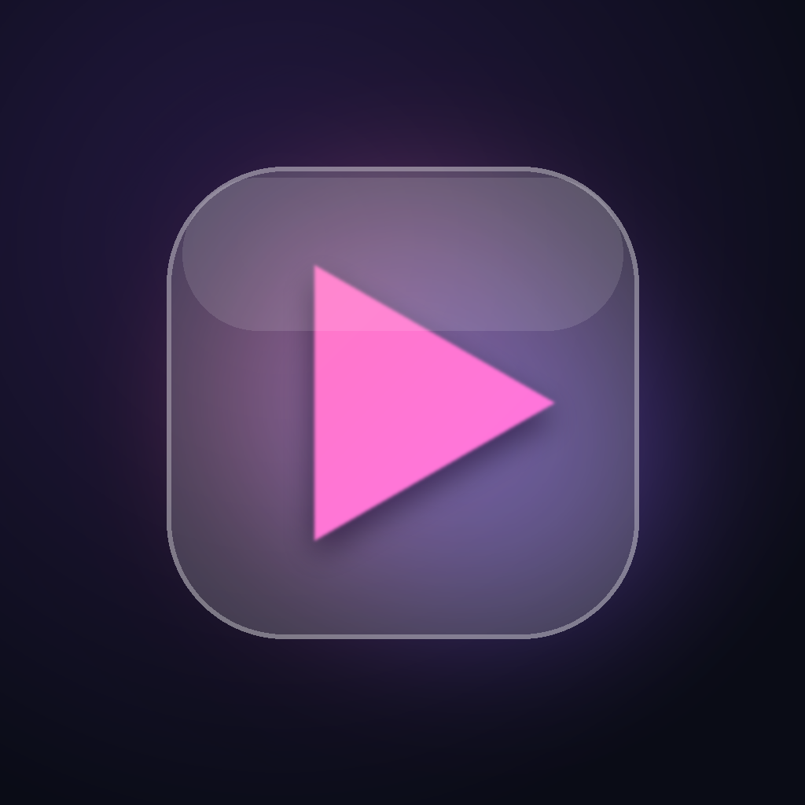

<p align="center"></p>

<h1 align="center">GlassPlayer</h1>

<p align="center">An mpv-powered media player for iPhone and iPad: every format, your Lua scripts and GLSL shaders, WebDAV, Stremio-style addons, intro skipping and Picture in Picture that keeps working outside the app.</p>

---

## Features

**Playback engine — libmpv**
- Plays anything mpv/FFmpeg can: MKV, HEVC/AV1/VP9, 10-bit, ASS/SSA subtitles with embedded fonts, PGS, multi-audio, HLS/DASH, RTSP, SMB/FTP/SFTP URLs
- VideoToolbox hardware decoding with automatic copy-back fallback
- Your own `mpv.conf`, `input.conf`, `script-opts/` — edited in-app or via the Files app
- **External Lua scripts**: drop `.lua` files (or folders with `main.lua`) into `mpv/scripts`, import them, or install from a URL. Toggle each one on/off.
- **GLSL shaders**: one-tap Anime4K (Mode A/B/C presets) and FSRCNNX downloads, any `.glsl`/`.hook` from a URL or file, per-video toggling from the player
- **Commands**: run any mpv command from the in-player console, or save buttons for script bindings (`script-binding …`) so touch users can trigger scripts
- Hardware keyboards are forwarded to mpv, so `input.conf` and script key bindings work on iPad

**Player UI (Outplayer-style, glass on iOS 26)**
- Double-tap to seek, swipe to scrub, swipe left/right edge for brightness/volume, pinch to fill, hold for 2× speed
- Side panels for audio/subtitle tracks, delays, speed, chapters, shaders, commands, aspect ratio, media info
- Seek bar shows chapters, cache and skip markers; lock screen, rotation lock, AirPlay, screenshots
- Resume playback, continue watching, autoplay next file in the folder

**Active Picture in Picture**
- Manual or automatic PiP when you leave the app, with play/pause/skip from the PiP window
- iOS forbids GPU rendering in the background, so during PiP mpv switches to its CPU renderer and switches back to the GPU when you return (shaders pause in PiP)

**Sources**
- **WebDAV**: Real-Debrid, TorBox, Premiumize presets or any server. Per-folder sort memory, clean titles, watched/progress badges, folder filter and a background **library-wide search** index. Passwords live in the Keychain.
- **Addons** (Stremio protocol, the same ones Nuvio uses): Cinemeta pre-installed; add Torrentio/Comet/MediaFusion (with your debrid key), OpenSubtitles, anime catalogs… Browse catalogs, search, episode lists, streams from all addons, addon subtitles attached automatically.
- Local files (Files app → GlassPlayer → Media), "Open in…" from other apps, URLs, `glassplayer://play?url=…`

**Skip intro / outro**
- Uses chapters in the file when present (Opening/OP/Ending/ED/Recap/Preview)
- Otherwise looks the anime up: AniList → ids.moe → **AniSkip** (exact ranges), falling back to **Open Anime Timestamps**
- Skip button or per-type auto-skip; found markers are injected as mpv chapters so your Lua scripts (e.g. op-ed-pv-skip) see them too

## Install

GlassPlayer isn't on the App Store. Download `GlassPlayer-x.y.z.ipa` from [Releases](../../releases) and sideload it with **AltStore / SideStore**, **Sideloadly**, **TrollStore**, or your own developer account. The IPA is unsigned; the sideloading tool signs it.

Requires iOS 17 or later.

## The mpv folder

Open **Files → On My iPhone → GlassPlayer → mpv**:

```
mpv/
├── mpv.conf          # options (same as desktop)
├── input.conf        # key bindings for hardware keyboards
├── scripts/          # *.lua or folder/main.lua — auto-loaded
├── scripts-disabled/ # scripts switched off in Settings → Scripts
├── script-opts/      # <script>.conf
├── shaders/          # *.glsl, *.hook
├── fonts/            # extra subtitle fonts
└── logs/last.log     # log of the last playback
```

### Script compatibility

| Works | Doesn't work on iOS |
|---|---|
| `mp.*` API, property observers, timers, events | `mp.utils.subprocess` / `subprocess_detached` |
| OSD messages and `mp.create_osd_overlay` (ASS drawing) | `io.popen`, `os.execute` (no curl, yt-dlp, ffmpeg) |
| `script-message`, `script-binding`, `user-data` | JavaScript (`.js`) scripts |
| Key bindings (hardware keyboard or saved Commands) | Mouse-only UIs (osc/uosc need a pointer) |
| Chapters from GlassPlayer's skip lookup | |

Scripts that need network access should use mpv's own stream loading, or let GlassPlayer do it (e.g. the built-in AniSkip/OAT lookup replaces curl-based OAT scripts).

### Shaders

Rendering uses OpenGL ES 3.0, so shaders with `//!COMPUTE` passes won't load. Anime4K, FSRCNNX, KrigBilateral, SSimSuperRes and adaptive-sharpen are fragment shaders and work.

## Building

Every push to `main` builds an unsigned IPA in GitHub Actions (artifact). Tags `v*` publish a release.

Local build (macOS + Xcode 16 or later):

```sh
brew install xcodegen
mkdir -p Vendor
curl -L -o /tmp/libmpv.zip https://github.com/libmpv-ios/mpv-ios/releases/download/v0.1.2/Libmpv.xcframework.zip
ditto -x -k /tmp/libmpv.zip Vendor/
xcodegen generate
open GlassPlayer.xcodeproj
```

## Credits & license

- [mpv](https://mpv.io) and [FFmpeg](https://ffmpeg.org), [libass](https://github.com/libass/libass), [libplacebo](https://code.videolan.org/videolan/libplacebo)
- Prebuilt libmpv for iOS from [libmpv-ios/mpv-ios](https://github.com/libmpv-ios/mpv-ios) (Apache-2.0); its research notes informed the render and PiP approach
- [AniSkip](https://aniskip.com), [Open Anime Timestamps](https://github.com/jonbarrow/open-anime-timestamps), [ids.moe](https://ids.moe), [AniList](https://anilist.co)
- [Anime4K](https://github.com/bloc97/Anime4K), [FSRCNNX](https://github.com/igv/FSRCNN-TensorFlow)
- Addon protocol by [Stremio](https://github.com/Stremio/stremio-addon-sdk)

The bundled FFmpeg is built with `--enable-gpl --enable-version3`, so GlassPlayer is distributed under the **GNU GPL v3** (see [LICENSE](LICENSE)).
